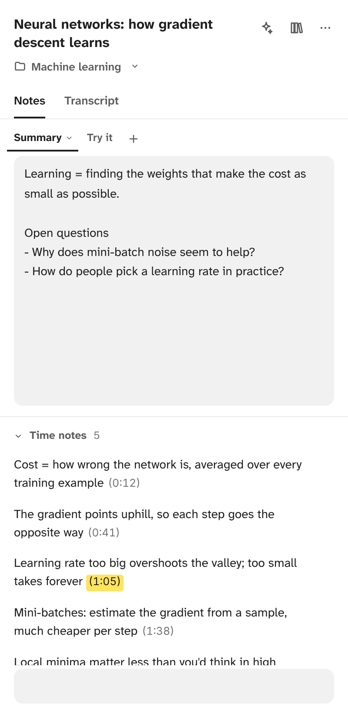
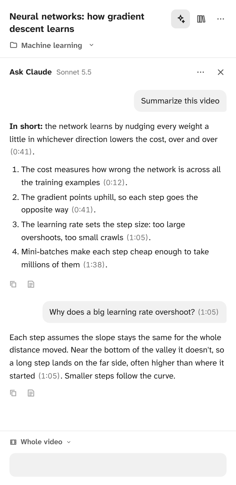
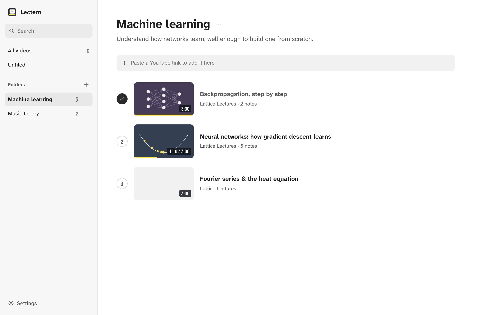

# Lectern

A study notebook for YouTube. Take notes that remember the moment you wrote them, keep each video's transcript with your notes, and line videos up in topic folders you can work through like a course.

  
  

## What makes it different

- **Private, no account.** Your notes, transcripts and folders stay in Chrome on your computer. There's no sign-up, no server and no analytics.
- **Folders that work like courses.** Queue up videos for a topic in the order you'll study them, see how far you got in each, and mark them finished.
- **Two kinds of notes.** Time notes are stamped with the video time when you save them. A notepad with pages holds the ideas that aren't tied to one moment.
- **The transcript stays with the video.** It's saved automatically, searchable alongside your notes, and every line jumps to its moment.
- **Bring your own AI, or none.** Ask Claude or OpenAI about the whole video or one moment, using your own API key. Answers cite times you can click. Everything else works without it.

## Install

Lectern isn't in the Chrome Web Store yet. To install it from this repo:

1. Download it: **Code → Download ZIP** above, then unzip it somewhere you'll keep it (Chrome loads it from there).
2. Open `chrome://extensions` and turn on **Developer mode** (top right).
3. Click **Load unpacked** and choose the folder that contains `manifest.json`.
4. Pin it: click the puzzle-piece icon in the toolbar, then the pin next to Lectern.

Works in Chrome 116 or newer, and in other Chromium browsers with side panels, such as Edge and Brave.

## Use it

**While watching**, click the toolbar icon (or press Alt+Shift+Y) to open the notes panel beside the video. From top to bottom:

- **Title and folder.** Pick a folder (or make a new one) under the title. A video is saved to your library the moment you write a note, get its transcript or pick a folder.
- **Notepad**, for ideas and notes that aren't tied to a moment. The **+** adds a page; once there are two or more, their tabs replace the "Notepad" title. Click the current tab to rename or delete it.
- **Time notes.** Each note ends with its time in small grey brackets, like `(0:37)`. Click the time to jump the video there; the one you're at is marked in yellow. Click a note's text to edit it. The chevron next to "Time notes" folds the list away.
- **The note box** under your time notes. Type and press Enter: the note is stamped with the video time at that moment. Shift+Enter adds a line.

Drag the divider between the notepad and time notes to give either more room; double-click it to split evenly again.

Alt+J, Alt+K and Alt+L rewind 5 seconds, play/pause and skip 5 seconds while you type. The note button in the YouTube player jumps straight to the note box, and Alt+Shift+M marks a moment without leaving the video.

**Transcript tab.** The transcript is fetched when you save a video (or click **Get transcript**). It follows along as the video plays; search it, click a line to jump there, or press + to turn a line into a note. The ⋯ menu has the follow-along switch, caption languages, copy, and pasting a transcript yourself.

**Ask about the video.** The sparkle icon in the panel's top bar opens Ask. The first time, connect your own Claude (Anthropic) or OpenAI API key and pick a model. Answers use the video's transcript and your time notes. The chip above the question box sets what you're asking about: the whole video, or around the current moment. The sparkle on a transcript line, or "Ask about this moment" in a note's ⋯ menu, asks about that exact spot. Answers can be copied or saved to your notepad. Each question uses your API credit.

**Library** (the Library button in the panel, or right-click the toolbar icon → Open library):

- One folder per topic, with folders inside folders for subtopics, and an optional line for what you want to learn.
- Paste YouTube links to queue videos before you watch them. Several links at once work.
- Drag videos into the order you'll study them, or onto a folder in the sidebar. Click the number to mark a video finished.
- Thumbnails show how far you got; clicking one resumes where you stopped.
- A video's page shows its time notes and notepad next to the transcript.
- Search (press `/`) looks through titles, notes, notepad pages and transcripts at once.

**Settings** are at the bottom of the library sidebar: automatic transcripts, pausing the video while you write, stamping notes a few seconds early, appearance, Ask, and backup.

## When YouTube changes

YouTube has no public way for extensions to read transcripts, so Lectern gets them the way your browser does: it asks the player in your tab to load captions and reuses that request, and falls back to reading YouTube's "Show transcript" panel. YouTube changes its page regularly, and when it does, transcript capture (and the note button in the player) can stop working until Lectern is updated.

What that means for you:

- **Your notes are safe.** Notes, timestamps, folders and the library only rely on the page's video player, which rarely changes.
- **Pasting always works.** In the Transcript tab, **Paste one** takes YouTube's "Show transcript" text or an SRT/VTT subtitle file.
- **Reporting takes one click.** When capture fails, **Report this video** opens a GitHub issue with the details filled in. You see everything before you submit it.

Fixes ship as updates. The test suite runs the whole extension against a mock YouTube, so a fix for one part doesn't quietly break another.

## Your data

Everything is stored in Chrome on your computer. Nothing is sent anywhere except the requests your browser already makes to youtube.com and, if you use Ask, your question with that video's transcript and time notes, sent to the provider you connected. Your API key stays in this browser and is never included in backups. See [PRIVACY.md](PRIVACY.md) for the details.

**Export backup** in Settings saves a `.json` copy; **Import backup** merges it back in, on this computer or another. Folders and single videos also export as Markdown with clickable timestamps. Removing the extension deletes its data, so export first.

## Permissions

- **Read and change data on youtube.com**: to read the video time, jump to timestamps, add the note button and read captions.
- **api.anthropic.com and api.openai.com**: used only by Ask, and only with a key you've added.
- **Side panel, storage, scripting, context menu**: the notes panel, saving your notes, transcript capture and the "Open library" menu item.

## Contributing

Bug reports are most useful with a video link; the in-app report links fill in the rest. To work on the code, see [CONTRIBUTING.md](CONTRIBUTING.md).

## License

[MIT](LICENSE). The bundled fonts, Atkinson Hyperlegible Next and Barlow Condensed, are under the SIL Open Font License.
